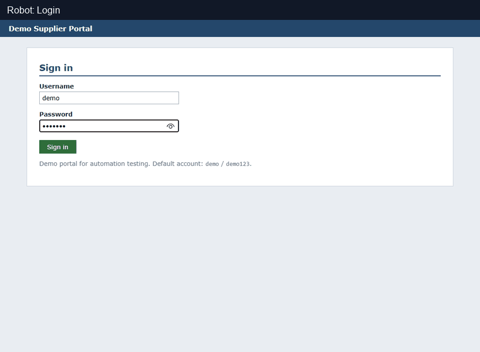

# Portal Robot

[](https://github.com/alelexand/portal-robot/actions/workflows/tests.yml)


A web robot (RPA) that does the repetitive portal work people usually do by hand every month. It **signs in, downloads reports and fills in forms** from a spreadsheet, then hands back an **Excel summary** of what was done, what the portal rejected and why.

It is built for real-world portals, which are slow, flaky and expire your session at the worst moment.



> The repository includes a **demo portal** (Flask) to run it against safely. All companies, VAT numbers and amounts are fictional.

## What it does

1. **Signs in** with credentials from a `.env` file (never in the code).
2. **Downloads reports**: for each row of `reports.csv` (company, month, report type) it fills the filters, waits for the report to be generated and saves the file to `downloads/<company>/<month>_<report>.csv`.
3. **Registers invoices**: for each row of `invoices.csv` it fills the form, submits it and records the protocol number. When the portal refuses a row (invalid VAT, negative amount, duplicate invoice), it records the portal's own error message and moves on.
4. **Reports back**: `summary.xlsx` with the status of each item, the result, the number of attempts, the time taken and a screenshot of every failure, plus a `run.log`.

```
  [OK ] report   Alpha Foods Lda · 2026-10 · Payroll summary    runs\demo\downloads\alpha-foods-lda\2026-10_payroll-summary.csv
  [OK ] invoice  Alpha Foods Lda · FT 2026/1187                 REQ-2026-00024
  [OK ] invoice  Delta Services BV · INV-7781                   REQ-2026-00027
  [REJ] invoice  Alpha Foods Lda · FT 2026/1190                 supplier_vat: Enter an EU VAT number, e.g. PT123456789.
  [REJ] invoice  Alpha Foods Lda · FT 2026/1187                 invoice_number: This invoice was already registered.

  9 done, 3 rejected by the portal, 0 failed
```

## Built for unreliable portals

| Problem | What the robot does |
|---|---|
| The page is slow or the report takes a while | Waits for the actual element (Playwright auto-waiting), never a fixed `sleep` |
| `503 Service unavailable` | Retries with exponential backoff (0.5s, 1s, 2s…) and gives up cleanly after N attempts |
| The session expires mid-task | Notices it, signs in again and repeats the step, without spending a retry |
| The portal rejects the data | Records the field and message and continues with the next row; no pointless retries |
| Wrong password | Stops at once, so it never locks the account with repeated attempts |
| An option that doesn't exist (e.g. a typo in the company) | Fails that row immediately with a clear message, instead of waiting for a timeout |
| Something unexpected | Saves a full-page screenshot so a person can see exactly what happened |

The demo portal simulates all of this on purpose: a CSRF-protected login, sessions that expire, reports generated asynchronously, server-side validation, pagination and a configurable rate of random 503 errors.

## Quick start

```bash
git clone https://github.com/alelexand/portal-robot.git
cd portal-robot
python -m venv .venv
# Windows: .venv\Scripts\activate   ·   macOS/Linux: source .venv/bin/activate
pip install -r requirements.txt
playwright install chromium        # or use an installed browser with --browser-channel msedge / chrome

python -m portal_robot demo                       # starts the demo portal and runs the robot against it
python -m portal_robot demo --headed --slow-mo 400   # same, but you watch the browser work
```

Try to break it:

```bash
python -m portal_robot demo --flaky 0.5 --session-ttl 3   # half the posts fail, sessions last 3 seconds
```

## Running against your own portal

The robot's selectors are written for the demo portal. Adapting it to another portal means changing the selectors and steps in `portal_robot/robot.py`. The structure (retries, re-login, screenshots, summary) stays the same.

```bash
cp .env.example .env               # set PORTAL_URL, PORTAL_USER, PORTAL_PASSWORD
python -m portal_robot run --reports my_reports.xlsx --invoices my_invoices.csv
```

The input files can be **CSV** (comma or semicolon) or **Excel**. See [`sample_data/`](sample_data) for the columns. The exit code is `1` when any item failed, so it can run from a scheduler (cron, Windows Task Scheduler) and alert someone.

To see the demo portal in your own browser: `python -m portal_robot serve` → http://127.0.0.1:5000 (user `demo`, password `demo123`).

## Project structure

```
portal_robot/
├── robot.py        # the robot: login, download_report, submit_invoice, retries, re-login, screenshots
├── files.py        # reads CSV/Excel to-do lists, writes the Excel summary
├── config.py       # settings from .env; the password never appears in logs
└── cli.py          # demo / serve / run
demo_portal/        # Flask app the robot is tested against
tests/              # 32 tests: portal unit tests + end-to-end tests with a real headless browser
tools/make_gif.py   # builds docs/demo.gif from the robot's step screenshots
```

## Tests

```bash
pip install -r requirements-dev.txt
pytest                                   # uses Playwright's Chromium
TEST_BROWSER_CHANNEL=msedge pytest       # or an installed browser
```

The end-to-end tests start the demo portal on a random port and drive a real browser against it: successful downloads and submissions, validation errors, giving up after repeated 503s, re-login after the session expires, and failing fast on invalid input.

## License

MIT. Built by [Alexandre Lasse](https://alelexand.github.io), freelance developer of automation and custom software for SMEs. Need a robot for a portal your team uses every month? [Get in touch](https://alelexand.github.io/#contact).
